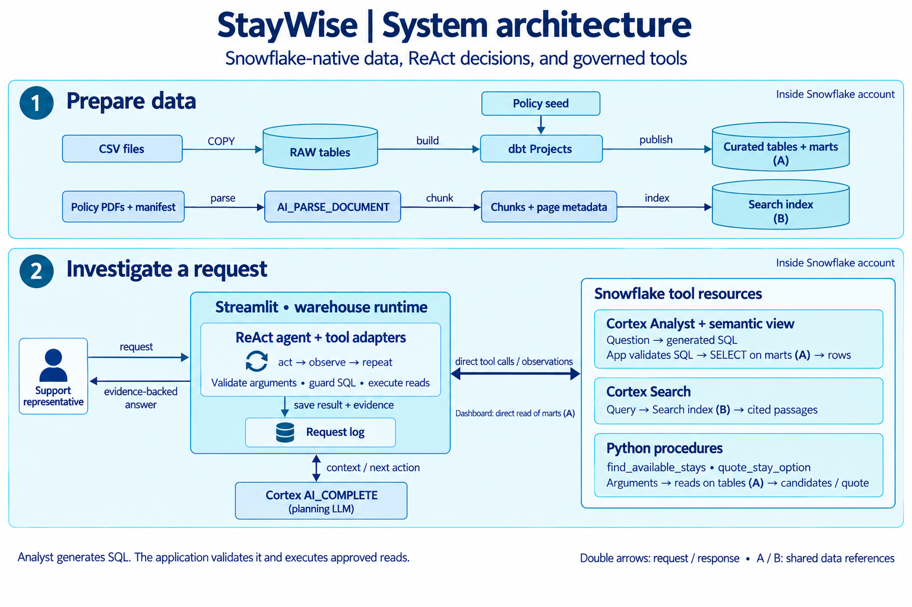
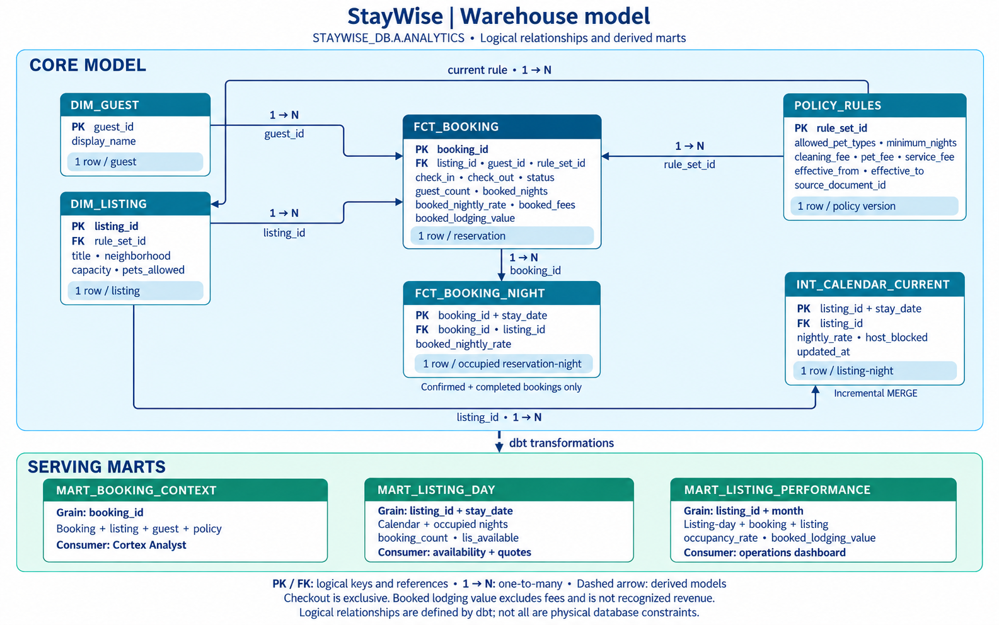

# StayWise — an guest-support agent project on Snowflake

StayWise helps a support representative answer a practical question: **can this guest extend their booking, and if not, which suitable alternative can we recommend with evidence?** The answer combines booking data, nightly availability, exact prices, and property-specific house rules.

All setup and execution happen in **Snowflake through Snowsight**: a dedicated project workspace, internal stages, dbt Projects on Snowflake, Cortex, and Streamlit's warehouse runtime. Start with [the complete runbook](RUNBOOK.md).

## The problem we solve

A representative receives this request for booking **B-1042**:

> Can I extend my stay by two nights? If it is unavailable, find a stay in Candolim for those extra nights, under ₹9,000 total. I am traveling with my cat.

Looking at a booking table alone cannot answer this. The original property might be occupied. A listing marked “pets allowed” might accept dogs only. A low nightly rate might exceed the total budget once fees are included. The representative needs a recommendation whose dates, eligibility, price, and policy evidence agree.

The supplied scenario has a reproducible outcome:

1. B-1042 is at **L001**, checking out on **23 September 2026**.
2. The extra stay is **23–25 September**: two nights, with checkout excluded.
3. L001 is occupied during that window, so extending it fails.
4. **L002** appears in coarse candidate search but its detailed rules allow dogs only.
5. **L003** allows cats and has both nights available.
6. Its quote is ₹7,000 lodging + ₹500 cleaning + ₹300 pet fee + ₹700 service fee = **₹8,500**, excluding taxes.
7. The agent recommends L003 only after obtaining an eligible quote and retrieving its applicable policy passage.

The route is chosen by the LLM from tool results. The answer is not a prewritten response or a hard-coded sequence of tool calls. No booking, charge, or refund is committed.

## Architecture

Open the image for a full-size view. **A** identifies the shared curated tables and marts; **B** identifies the document search index. The application runs in Streamlit's Snowflake warehouse runtime and saves investigations to the Snowflake table `APP.REQUEST_LOG`. The support representative accesses it through the browser.

The ReAct agent calls Cortex Analyst and Cortex Search through Snowflake’s authenticated in-account API bridge. It invokes the availability and quote procedures through the active Snowpark session. Cortex AI_COMPLETE chooses the next action from the request and accumulated tool results. The application validates generated SQL before executing read queries against the booking mart.

## Components and responsibilities

| Component | Implementation | Why it matters |
|---|---|---|
| Internal stages and RAW tables | Upload supplied CSVs/PDFs, then load structured data with COPY | Separate files, metadata, and relational data |
| dbt Projects on Snowflake | Staging views, dimensions, facts, incremental calendar, marts, seeds, tests | Build trustworthy inputs for AI |
| Document pipeline | Parse PDFs, retain page metadata, chunk text, create Cortex Search | Ground answers in retrieved evidence |
| Semantic view and Analyst | Define booking dimensions/metrics and generate read queries | Answer structured questions in business language |
| Python procedures | Search candidates and calculate deterministic quotes | Keep money and hard rules outside the LLM |
| ReAct loop | Call a planning LLM, validate a tool call, observe its result, repeat | Change the next action when new evidence arrives |
| Streamlit | Booking desk, comparison, operations, integration checks | Bring the workflow into a usable application |

## Where the LLM calls happen

`app/agent.py` calls **AI_COMPLETE** for each next-action decision. The prompt contains the request, fixed form constraints, available tool definitions, and observations so far. Structured JSON tells Python whether to call a tool, ask for clarification, or finish.

For `query_stay_data`, **Cortex Analyst** makes a separate model-backed text-to-SQL request. The adapter validates the returned SQL and executes an approved read against the booking mart. **Cortex Search** retrieves indexed passages. Availability, fee arithmetic, and final eligibility are deterministic Python/SQL operations.

Each observation becomes input to the next iteration. The loop permits at most eight tool observations, stops after three errors, rejects identical repeated calls, and checks a 180-second budget between iterations. That time budget does not interrupt an already-running service request. The displayed trace contains actions and evidence, not hidden model reasoning.

## The data layer

| Dataset | Supplied size | Grain / purpose |
|---|---:|---|
| Listings | 30 | One property across Candolim, Anjuna, or Panaji |
| Guests | 150 | One synthetic guest |
| Bookings | 500 | One reservation, including status and original price |
| Calendar | 5,400 | 30 properties × 180 nights starting 1 July 2026 |
| Policy rules | 30 | One versioned rule set with species, fees, and effective dates |
| PDF policies | 31 | 30 property policies plus one general support guide |
| Evaluation cases | 12 | Seven procedure scenarios and five agent scenarios |

### Warehouse model

The diagram shows selected columns and logical relationships, not a complete physical schema. Solid connectors show one-to-many references; the dashed connector groups downstream dbt transformations. Each serving mart lists its inputs and consumer. `fct_booking_night.listing_id` also references `dim_listing`; its field label records that relationship without an additional crossing line.

`dim_listing` and `dim_guest` provide descriptive attributes. `fct_booking` preserves reservation grain. `fct_booking_night` expands active bookings into occupied nights. `int_calendar_current` merges calendar updates. `mart_listing_day` combines rates, host blocks, and occupancy. `mart_booking_context` is the easy-to-query Analyst table. `mart_listing_performance` supplies monthly operations metrics.

“Booked lodging value” excludes cancelled reservations and fees; it is not recognized revenue. Checkout is exclusive everywhere. “Same neighborhood” is an exact match rather than a distance calculation. Policies and calendar dates are fixed for the reference scenario, with **18 September 2026** as the reference date.

## Four tools and their contracts

| Agent tool | Implementation | Output |
|---|---|---|
| `query_stay_data` | Analyst → SQL guard → approved Snowflake SELECT | Rows, SQL, and query IDs |
| `search_stay_documents` | Listing-filtered Cortex Search | Passages, document IDs, pages, and rule versions |
| `find_available_stays` | Snowflake Python procedure | At most five candidates with lodging estimates |
| `quote_stay_option` | Snowflake Python procedure | Eligibility, itemized total, and policy provenance |

A candidate is only an initial shortlist entry. A final recommendation must have an eligible quote, match the request, fit the complete budget, and cite the retrieved policy version that applies to its dates.

## Project files

| Path | Read it for |
|---|---|
| [RUNBOOK.md](RUNBOOK.md) | Every Snowsight setup, deployment, validation, update, and shutdown step |
| [sql/](sql/) | SQL scripts run from the project workspace to create infrastructure, services, and the app |
| [dbt/](dbt/) | Transformation models, native profile, seed configuration, and data tests |
| [app/agent.py](app/agent.py) | The complete ReAct loop and final evidence checks |
| [app/tools.py](app/tools.py) | Tool schemas and Snowflake service adapters |
| [snowflake_tools/stay_tools.py](snowflake_tools/stay_tools.py) | Availability and quote business logic |
| [streamlit_app.py](streamlit_app.py) | The four application pages |
| [app/evaluation.py](app/evaluation.py) | Runner for the cases in data/evaluation_cases.json |
| [data/diagrams/](data/diagrams/) | Architecture and warehouse model images, with their [image-generation prompts](data/diagrams/generation_prompts.json) |
| [data/](data/) | Source CSVs, policy seed, PDFs, data manifest, evaluation cases, and diagram assets |

## End-to-end workflow

Load and validate the RAW and dbt layers, then parse the policy PDFs and build the Search index. Verify the deterministic quote procedures before deploying Streamlit. An end-to-end investigation should recover from the unavailable extension and return the eligible alternative with its policy evidence.

Additional verification cases cover an insufficient budget, policy-only retrieval, booking statistics, and incremental calendar updates. Workspace setup, deployment commands, expected results, and operational steps are maintained in [RUNBOOK.md](RUNBOOK.md).

The project uses an X-Small warehouse and Snowflake's managed warehouse runtime. Trial credits and feature availability are account constraints: run the preflight before deployment. Snowflake's [trial documentation](https://docs.snowflake.com/en/user-guide/admin-trial-account#current-limitations-for-trial-accounts) lists external-access restrictions and Cortex usage limits. This project does not require external network access.
